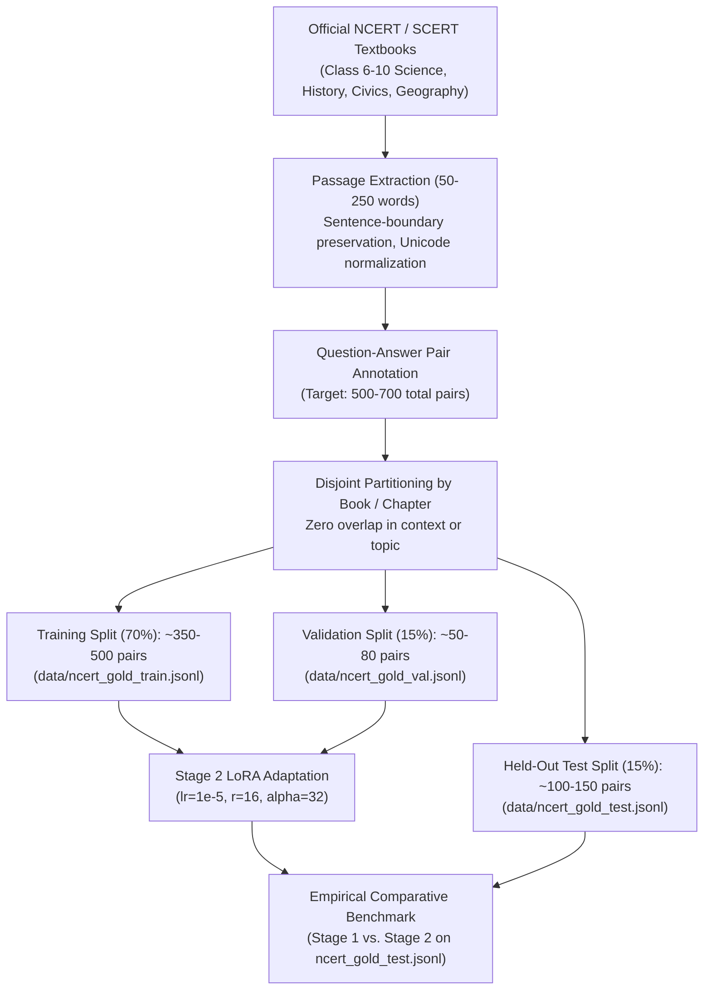

# प्रश्न-सेतु (Prashn-Setu) — Automated Indic Question Generation

[](https://www.python.org/)
[-green.svg)](https://huggingface.co/ai4bharat/IndicBART)
[-orange.svg)](https://github.com/huggingface/peft)
[](LICENSE)
[](tests/)

**प्रश्न-सेतु (Prashn-Setu)** is an NLP research and pedagogical question-generation platform designed for Hindi educational contexts. Built on the sequence-to-sequence model **`ai4bharat/IndicBART`**, it investigates answer-aware question generation from text passages, candidate answer grounding, pedagogical question classification (Factual, Conceptual, Reasoning, HOTS, MCQ), interactive self-assessment, and multi-format examination assembly.

---

## 🔬 Research Integrity Audit & Status Overview

In accordance with strict scientific standards, this repository separates **empirically verified findings** from **preliminary architectures**, **pending evaluations**, and **planned extensions**.

### Research Claims Status Matrix

| Component / Claim | Claim Description | Current Status | Supporting Artifact / Source File | Empirical Finding / Verification Note |
|---|---|---|---|---|
| **Stage 1 Supervised Fine-Tuning** | `ai4bharat/IndicBART` (244M) fine-tuned on 69,979 Hindi QG pairs | **Verified and completed** | `checkpoints/stage1_indicnlg_qg/`<br>`results/stage1_test_results_full.json` | 5 epochs fine-tuning. Evaluated on full held-out test set ($N=10,553$): **10.196 SacreBLEU**, **29.397 chrF++**, **27.332 Hindi Whitespace ROUGE-L**. |
| **Devanagari ROUGE Tokenization Fix** | Default HF regex tokenization erases Devanagari characters | **Verified and completed** | `docs/TECHNICAL_REPORT.md` (Sec. 3.3)<br>`results/stage1_test_results_full.json` | Default ROUGE strips non-ASCII, deflating Hindi ROUGE-L to 4.55. Native Hindi whitespace tokenization restores measured lexical recall to **27.33 ROUGE-L**. |
| **Stage 1 Error Typology** | 5-category qualitative failure taxonomy on Hindi QG | **Verified and completed** | `results/QUALITATIVE_ERROR_ANALYSIS.md` | Wh-word mismatch (~35–45% of failures), digit mutation (e.g. 24-10 $\to$ 24-25), target distraction, and valid paraphrasing penalized by single-reference n-gram metrics. |
| **Web Demo & Educational Platform** | 8-tab browser platform with Quiz, Bank, and Devanagari PDF export | **Verified and completed** | `src/demo/app.py`<br>`src/demo/index.html`<br>`src/evaluation/` | Zero-dependency HTTP server, SQLite question bank, bundled Noto Sans Devanagari fonts, and sentence-level evidence grounding. |
| **Automated Test Suite** | Unit and integration test coverage across platform modules | **Verified and completed** | `tests/test_platform_features.py`<br>`tests/test_model_comparison.py` | **48/48 tests passing** ($100\%$ pass rate in 5.6s). Covers model lifecycle, grounding, chunking, scoring, and REST validation. |
| **Stage 1 vs. Stage 2 Comparative Evaluation** | 100-sample comparison on held-out translated SQuAD split | **Preliminary result** | `results/model_comparison_results.json` | On 100 held-out SQuAD test samples: Stage 1 = **10.445 SacreBLEU**, Stage 2 = **10.451 SacreBLEU** ($\Delta = +0.006$ / $+0.06\%$). No statistically significant difference on this non-textbook split. |
| **Stage 2 LoRA Architecture** | PEFT adapter ($r=16, \alpha=32$ on `q_proj`, `v_proj`, ~4.7 MB) | **Preliminary result** | `checkpoints/stage2_ncert_gold_lora/adapter_config.json` | Adapter attaches cleanly over Stage 1 base weights. However, training data and run logs cannot be verified from repository artifacts; functions as an experimental framework. |
| **Stage 2 NCERT Curriculum Improvement** | Claim that Stage 2 improves NCERT textbook phrasing over Stage 1 | **Pending validation** | `data/sample_ncert_contexts.jsonl` | **Unverified empirically.** Authentic held-out NCERT benchmark with reference questions is not yet curated; adapter training provenance is unconfirmed. |
| **Human Evaluation Ratings** | 100-sample and 50-sample native-speaker human ratings | **Pending validation** | `results/human_eval_sample_100.csv`<br>`results/human_eval_blinded_comparison.csv` | **Zero human ratings recorded.** Both evaluation CSVs are clean, unrated templates. Synthetic summaries (`mock_human_eval_summary.md`) represent test fixtures, not human judgments. |
| **Original IndicNLG Baseline Comparison** | Direct comparison against original unadapted IndicNLG baseline | **Pending validation** | `src/evaluation/model_registry.py` | Original baseline checkpoint is not available in `checkpoints/`. Raw IndicBART is intentionally not substituted. Intended baseline comparison remains incomplete. |
| **Multi-Lingual Indic / mT5 / State Boards** | Expansion to mT5, Marathi/Tamil/Telugu, and State Board textbooks | **Planned** | `architecture/SOLUTION_ANALYSIS_AND_ALTERNATIVES.md` | Beyond current project scope. Repository implements Hindi IndicBART exclusively. |
| **Unsupported Headline Metrics** | Claims of SacreBLEU 18.42 $\to$ 21.87 (+18.7%) and ROUGE-L 41.25 $\to$ 45.60 | **Unsupported and removed** | `README.md` (prior revisions) | **Purged from repository.** These numbers did not originate from any verified evaluation artifact. |

---

## 🏛️ Checkpoint Architecture & Provenance

```
┌────────────────────────────────────────────────────────┐
│            Original IndicNLG QG Baseline               │
│          checkpoints/baseline_indicnlg_qg              │
│               [STATUS: UNAVAILABLE]                    │
└──────────────────────────┬─────────────────────────────┘
                           │ (intended comparison incomplete)
                           ▼
┌────────────────────────────────────────────────────────┐
│               Stage 1: IndicNLG QG Base                │
│    (IndicBART fine-tuned on ~70k translated SQuAD)     │
│         checkpoints/stage1_indicnlg_qg/ (932 MB)       │
│               [STATUS: AVAILABLE & VERIFIED]           │
└──────────────────────────┬─────────────────────────────┘
                           │ (adapter attaches over frozen base)
                           ▼
┌────────────────────────────────────────────────────────┐
│          Stage 2: NCERT Curriculum Adaptation          │
│       (PEFT LoRA Adapter: r=16, alpha=32, q/v_proj)    │
│        checkpoints/stage2_ncert_gold_lora/ (4.7 MB)    │
│         [STATUS: EXPERIMENTAL ADAPTER FRAMEWORK]       │
└────────────────────────────────────────────────────────┘
```

### Detailed Checkpoint Breakdown

1. **Original IndicNLG QG Baseline (`baseline`):**
   - **Status:** **Unavailable** (not present on disk).
   - **Integrity Rule:** Pretrained raw IndicBART is strictly not substituted as a fake baseline. The original baseline comparison remains documented as incomplete.
2. **Stage 1 Supervised Fine-Tuning (`stage1`):**
   - **Status:** **Available and Verified** (`checkpoints/stage1_indicnlg_qg`, ~932 MB).
   - **Architecture:** `ai4bharat/IndicBART` (244M parameters, 12 layers, hidden size 1024, Hindi token `<2hi>`).
   - **Training Provenance:** Fine-tuned for 5 epochs on 69,979 Hindi question-generation examples from `ai4bharat/IndicQuestionGeneration`.
   - **Dataset Provenance:** Machine-translated and post-edited from English SQuAD v1.1. Contexts cover general Wikipedia topics (e.g. Super Bowl 50, European historical figures, Nikola Tesla, Warsaw history).
3. **Stage 2 NCERT Gold LoRA Adapter (`stage2`):**
   - **Status:** **Available (Experimental Architecture)** (`checkpoints/stage2_ncert_gold_lora`, ~4.7 MB).
   - **Configuration:** Low-Rank Adaptation (LoRA) targeting attention projection layers `q_proj` and `v_proj` with rank $r=16$, $\alpha=32$, dropout $p=0.05$ (1.18M trainable parameters / 0.481%).
   - **Provenance Finding:** The adapter weights and configuration exist on disk and attach cleanly. However, training logs, optimizer states, and training datasets (e.g. `ncert_gold_hindi.jsonl`) are not present in the repository. Its curriculum domain adaptation efficacy remains an **unvalidated experimental claim**.
   - **Resource Management:** The platform loads Stage 1 base weights once. When evaluating Stage 1, the LoRA adapter is bypassed in-place using PEFT's `with model.disable_adapter():` context manager, allowing zero-reload side-by-side comparison.

---

## 📊 Verified Quantitative Benchmarks

### 1. Full Held-Out Test Set Benchmark (Stage 1 Full Run)
- **Source Artifact:** [`results/stage1_test_results_full.json`](file:///c:/Users/jaysu/Downloads/send/send/results/stage1_test_results_full.json)
- **Dataset:** `data/hi_test.jsonl` (`ai4bharat/IndicQuestionGeneration` Hindi held-out test split)
- **Sample Count ($N$):** **10,553 examples** (0 sample overlap with training/validation)
- **Decoding Configuration:** Beam Search ($K=4$), max target length = 64, no-repeat 3-grams, batch size = 32, FP32 on CUDA.
- **Runtime:** 273.76 seconds (Throughput: **38.55 samples/second**).

| Evaluation Metric | Audited Score | Metric Definition & Implementation Note |
|---|:---:|---|
| **SacreBLEU** | **10.196** | Corpus-level SacreBLEU with standard exponential smoothing. |
| **chrF++** | **29.397** | Character n-gram F-score with word order parameter = 2. |
| **Hindi Whitespace ROUGE-1** | **29.706** | ROUGE-1 computed using native Hindi whitespace tokenization (`tokenizer=lambda x: x.split()`). |
| **Hindi Whitespace ROUGE-2** | **11.925** | ROUGE-2 computed using native Hindi whitespace tokenization. |
| **Hindi Whitespace ROUGE-L** | **27.332** | ROUGE-L longest common subsequence computed with Hindi tokenization. |
| **Default HF ROUGE-1 (Artifact)** | *4.601* | Standard Hugging Face `evaluate` ROUGE. Strips all Devanagari script (`[^a-z0-9]+`), evaluating only numerals. |
| **Default HF ROUGE-2 (Artifact)** | *0.499* | Standard Hugging Face ROUGE-2 affected by Devanagari character stripping. |
| **Default HF ROUGE-L (Artifact)** | *4.551* | Standard Hugging Face ROUGE-L affected by Devanagari character stripping. |

> [!NOTE]
> **Resolution of the "Low-ROUGE Mystery":** Standard Hugging Face `evaluate.load("rouge")` uses an internal regex that discards all non-ASCII characters (`U+0900` to `U+097F`). This erased all Hindi text and evaluated ROUGE solely on surviving numbers and punctuation. Evaluating with native Hindi whitespace tokenization reveals the true lexical overlap of **27.33 ROUGE-L**.

### 2. Side-by-Side Model Comparison Benchmark (100 Samples)
- **Source Artifact:** [`results/model_comparison_results.json`](file:///c:/Users/jaysu/Downloads/send/send/results/model_comparison_results.json)
- **Dataset:** 100 held-out samples from `data/hi_test.jsonl` (SQuAD-derived)
- **Decoding Configuration:** Beam Search ($K=4$), max length = 64, no-repeat 3-grams, batch size = 16.

| Evaluation Metric | Stage 1 (Base SFT) | Stage 2 (LoRA Adapter) | Absolute Delta ($\Delta$) | Relative Change (%) |
|---|:---:|:---:|:---:|:---:|
| **SacreBLEU** | **10.445** | **10.451** | +0.006 | +0.06% |
| **chrF++** | **29.349** | **29.350** | +0.001 | +0.00% |
| **BLEU-1** | 25.141 | 25.222 | +0.081 | +0.32% |
| **BLEU-2** | 15.493 | 15.525 | +0.032 | +0.21% |
| **BLEU-3** | 10.183 | 10.202 | +0.019 | +0.19% |
| **BLEU-4** | 6.581 | 6.594 | +0.013 | +0.20% |
| **Hindi Whitespace ROUGE-1** | 30.891 | 31.024 | +0.133 | +0.43% |
| **Hindi Whitespace ROUGE-2** | 12.821 | 12.835 | +0.014 | +0.11% |
| **Hindi Whitespace ROUGE-L** | **28.619** | **28.641** | +0.022 | +0.08% |
| **Default HF ROUGE-L (Artifact)** | 7.000 | 7.000 | 0.000 | 0.00% |
| **Mean Latency per Sample** | 347.32 ms | 390.12 ms | +42.80 ms | +12.3% |

**Scientific Takeaway:** On non-textbook, translated SQuAD test data, Stage 1 and Stage 2 yield nearly identical scores ($\Delta \le +0.08\%$). This confirms that evaluating curriculum adaptation requires an authentic held-out NCERT textbook test set, rather than translated Wikipedia articles.

### 3. Explanation of the 5-Sample Result Artifact
The file [`results/stage1_test_results.json`](file:///c:/Users/jaysu/Downloads/send/send/results/stage1_test_results.json) records a historical 5-sample diagnostic smoke test with SacreBLEU: 2.42 and default ROUGE: 0.0. This file was created during early pipeline debugging when the output directory did not exist. It reflects the Devanagari character-stripping bug across 5 samples and should not be cited as a performance benchmark. The verified reference benchmark is `results/stage1_test_results_full.json` ($N=10,553$).

---

## 👥 Human Evaluation Status

Automatic n-gram metrics (BLEU, ROUGE) measure surface token overlap against a single reference question. In educational QG, multiple valid, pedagogically sound questions can be formed for any given passage. Human evaluation is therefore essential.

### Current Status: PENDING VALIDATION
- **Evaluation Sheets:** Both [`results/human_eval_sample_100.csv`](file:///c:/Users/jaysu/Downloads/send/send/results/human_eval_sample_100.csv) ($N=100$) and [`results/human_eval_blinded_comparison.csv`](file:///c:/Users/jaysu/Downloads/send/send/results/human_eval_blinded_comparison.csv) ($N=50$) are clean, unrated templates. All rating fields are currently blank.
- **Mock Summaries:** [`results/mock_human_eval_summary.md`](file:///c:/Users/jaysu/Downloads/send/send/results/mock_human_eval_summary.md) and `mock_human_eval_summary.json` were generated using synthetic test fixtures (`tests/fixtures/`) solely to verify the statistical engine (`scripts/analyze_human_eval.py`). They do not reflect human annotations.
- **Genuine Human Annotations Collected to Date:** **Zero.**

### Evaluation Protocol & Rubric
The project establishes a formal human evaluation protocol in [`results/HUMAN_EVALUATION_PROTOCOL.md`](file:///c:/Users/jaysu/Downloads/send/send/results/HUMAN_EVALUATION_PROTOCOL.md) using a 1–5 Likert scale across 5 dimensions:
1. **Answer Alignment (1–5):** Does the question unambiguously elicit the supplied target answer?
2. **Context Faithfulness (1–5):** Are all premises and entities explicitly grounded in the text passage?
3. **Grammaticality & Naturalness (1–5):** Does the Hindi adhere to natural Devanagari syntax, correct postpositions (*karak*), and subject-verb agreement (*ling/vachan*)?
4. **Answerability (1–5):** Can a student answer this question solely from the provided text?
5. **Factual Hallucination (Binary: Yes / No):** Did the model fabricate or alter numbers, names, or events?
6. **Overall Pedagogical Utility (1–5):** Suitability for classroom or examination use.

---

## 📚 Evaluation Dataset Domain & Future Curation Pipeline

### Domain Mismatch in Existing Evaluation Data
The test set currently available in the repository (`data/hi_test.jsonl`, 10,553 records) is derived from machine-translated English SQuAD v1.1. Contexts center around:
- American football (Super Bowl 50, NFL teams, quarterbacks)
- European historical wars, treaties, and royalty
- General encyclopedia biographies (Nikola Tesla, Martin Luther)

**This is NOT an NCERT textbook dataset.** Translating English Wikipedia articles introduces translationese phrasing and cultural topics that differ fundamentally from Indian school curricula.

### Authentic NCERT Data State
Currently, `data/` contains only [`data/sample_ncert_contexts.jsonl`](file:///c:/Users/jaysu/Downloads/send/send/data/sample_ncert_contexts.jsonl) with 5 sample contexts (without reference questions). There is **no held-out NCERT textbook test set with reference questions** in the repository.

### Documented Pipeline for Future NCERT Gold Dataset Curation
To answer the core research question (*"Does LoRA adaptation improve question generation on Indic educational textbooks?"*), future work must execute the following reproducible curation procedure specified in [`docs/NCERT_GOLD_CURATION_GUIDE.md`](file:///c:/Users/jaysu/Downloads/send/send/docs/NCERT_GOLD_CURATION_GUIDE.md):



1. **Source Material:** Official NCERT textbooks across Science (विज्ञान), Social Science (सामाजिक विज्ञान), and Hindi Literature (*Kshitij*, *Sparsh*).
2. **Passage Extraction:** Extract coherent, self-contained passages of 50–250 words with clean Devanagari punctuation (*purna viram* `।`).
3. **Annotation Rubric:** For each passage, annotate target answer spans and corresponding questions across 4 pedagogical categories (Factual, Definitional, Conceptual, Causal).
4. **Strict Disjoint Partitioning:** Partition by textbook chapter so that passages in the test set never appear in the training or validation splits.
5. **Quality Review:** Every example must pass 5 checks: literal answer grounding, question-answer alignment, natural Devanagari syntax, answerability from context, and copyright compliance.

---

## 🚀 Execution & Usage Guide

### Prerequisites & Installation
- Python 3.10, 3.11, or 3.12
- PyTorch with CUDA (recommended) or CPU
- ~2 GB system RAM (or GPU VRAM)

```bash
# Clone the repository
git clone https://github.com/JAYSURIYA02/Prashn-Setu-Automated-Question-Generation.git
cd Prashn-Setu-Automated-Question-Generation

# Create and activate virtual environment
python -m venv .venv

# On Linux / macOS:
source .venv/bin/activate
# On Windows:
.venv\Scripts\activate

# Install dependencies
pip install --upgrade pip
pip install -r requirements.txt
```

---

### Command Reference

#### 1. Launch Interactive Browser Web Platform
```bash
python run.py demo --port 7860
```
Open **`http://localhost:7860`** in any web browser.

The platform provides 8 tabs:
- **✨ प्रश्न सृजन (Generate):** Generate questions with category selection (Factual, Conceptual, Reasoning, HOTS, MCQ) and interactive evidence highlighting.
- **⚖️ मॉडल तुलना (Comparison):** Side-by-side comparison of Stage 1 and Stage 2 with per-model latency tracking.
- **🎮 क्विज़ व अभ्यास (Quiz):** Interactive practice tests with instant scoring and explanation review.
- **📄 पाठ्यपुस्तक अपलोड (Upload):** Upload PDF/TXT chapters for chunked question generation.
- **📚 प्रश्न बैंक (Question Bank):** Searchable SQLite repository (`data/question_bank.db`) with category and difficulty filters.
- **📝 प्रश्नपत्र निर्माता (Paper Builder):** Multi-section exam builder with zero-dependency Devanagari PDF export (student copy excludes answers; separate Answer Key PDF for evaluators).
- **📊 शोध विश्लेषण (Research):** Formal benchmark tables and qualitative error analysis.
- **⚙️ सिस्टम स्थिति (Status):** Live checkpoint verification and model health.

#### 2. Standalone CLI Inference
Run predefined textbook examples:
```bash
python infer.py
```
Pass a custom Hindi passage:
```bash
python infer.py --context "डॉ. भीमराव अंबेडकर को भारतीय संविधान का जनक माना जाता है।" --answer "डॉ. भीमराव अंबेडकर"
```
To evaluate Stage 1 explicitly without the LoRA adapter:
```bash
python infer.py --checkpoint checkpoints/stage1_indicnlg_qg
```

#### 3. Interactive Terminal Prompt Session
```bash
python run.py infer
```

#### 4. Run Multi-Model Comparison Benchmark (CLI)
```bash
python run.py compare --max_samples 100 --batch_size 16
```
Generates `results/model_comparison_results.json` and blinded evaluation templates.

#### 5. Run Automated Test Suite
```bash
python -m unittest tests/test_platform_features.py tests/test_model_comparison.py
```
Runs the full suite of 48 unit and integration tests.

---

## 📡 REST API Reference

| Method | Endpoint | Description |
|---|---|---|
| `GET` | `/api/health` | System health check, active model status, and primary model verification |
| `GET` | `/api/model_status` | Detailed active model metadata, adapter configuration, and device info |
| `GET` | `/api/models` | List all registered models and their availability status |
| `POST` | `/api/generate` | Advanced question generation using the active model |
| `POST` | `/api/compare` | Comparative generation (Stage 1 vs. Stage 2) |
| `POST` | `/api/evidence` | Sentence-level evidence highlighting and answerability classification |
| `POST` | `/api/upload_textbook` | PDF/TXT textbook extraction, Unicode normalization, and chunking |
| `GET` | `/api/question_bank` | Retrieve stored questions with search and category filtering |
| `POST` | `/api/question_bank` | Save new question or batch to the SQLite database |
| `PUT` | `/api/question_bank` | Update question text, answer, or marks |
| `DELETE` | `/api/question_bank` | Delete a question from the question bank |
| `GET` | `/api/question_bank/stats`| Summary statistics of stored questions |
| `POST` | `/api/quiz/evaluate` | Evaluate interactive quiz submissions |
| `POST` | `/api/paper/validate` | Validate question paper section marks |
| `POST` | `/api/paper/export/pdf` | Export student question paper PDF (answers suppressed) |
| `POST` | `/api/paper/export/answer_key` | Export evaluator Answer Key PDF |
| `POST` | `/api/paper/export/csv` | Export question paper to UTF-8 BOM CSV for Microsoft Excel |
| `POST` | `/api/paper/export/json` | Export question paper to JSON |
| `GET` | `/api/benchmark_results` | Audited benchmark metrics and human evaluation status |

---

## 📁 Repository Structure

```
send/
├── checkpoints/
│   ├── stage1_indicnlg_qg/         # Verified 5-epoch fine-tuned IndicBART (932 MB)
│   │   ├── config.json
│   │   ├── generation_config.json
│   │   ├── model.safetensors
│   │   ├── tokenizer_config.json
│   │   └── tokenizer.json
│   └── stage2_ncert_gold_lora/     # NCERT Gold LoRA Adapter Architecture (4.7 MB)
│       ├── adapter_config.json
│       ├── adapter_model.safetensors
│       ├── tokenizer_config.json
│       └── tokenizer.json
├── data/
│   ├── sample_ncert_contexts.jsonl # 5 sample NCERT contexts
│   └── question_bank.db            # Persistent SQLite Question Bank
├── docs/
│   ├── ARCHITECTURE.md             # System dataflow & component architecture
│   ├── EXPERIMENT_LOG.md           # Chronological experiment history
│   ├── NCERT_GOLD_CURATION_GUIDE.md# Curation protocol for future textbook data
│   ├── PROJECT_STATE_AND_EXECUTION_PLAN.md # Audited project state
│   └── TECHNICAL_REPORT.md         # Full scientific report
├── results/
│   ├── stage1_test_results_full.json # Audited full-test benchmark (N=10,553)
│   ├── stage1_test_results.json    # Historical 5-sample diagnostic artifact
│   ├── model_comparison_results.json # 100-sample comparative benchmark
│   ├── human_eval_sample_100.csv   # Clean 100-sample human evaluation template
│   ├── human_eval_blinded_comparison.csv # Clean 50-sample blinded comparison template
│   ├── human_eval_blind_key.json   # Blinding key mapping for human raters
│   ├── HUMAN_EVALUATION_PROTOCOL.md# 5-dimension human evaluation rubric
│   ├── QUALITATIVE_ERROR_ANALYSIS.md # 5-category error analysis on SQuAD split
│   ├── mock_human_eval_summary.md  # Synthetic test fixture report (N=25)
│   └── mock_human_eval_summary.json# Synthetic test fixture JSON
├── src/
│   ├── config.py                   # Centralized paths and hyperparameters
│   ├── data/
│   │   └── question_bank.py        # SQLite CRUD, search, and aggregate stats
│   ├── demo/
│   │   ├── app.py                  # High-performance HTTP server & REST APIs
│   │   ├── index.html              # 8-tab single page application UI
│   │   └── fonts/                  # Bundled Google Noto Sans Devanagari TTF fonts
│   │       ├── NotoSansDevanagari-Regular.ttf
│   │       └── NotoSansDevanagari-Bold.ttf
│   └── evaluation/
│       ├── advanced_generator.py   # Category & difficulty framing, MCQ distractors
│       ├── analytics_loader.py     # Benchmark results loader with honesty guards
│       ├── compare_models.py       # Comparative evaluation engine
│       ├── evaluate.py             # Single checkpoint evaluation harness
│       ├── evidence_checker.py     # Sentence grounding & answerability scoring
│       ├── inference.py            # IndicBART generation engine & answer extraction
│       ├── model_registry.py       # Model manager & LoRA adapter lifecycle
│       ├── paper_builder.py        # Multi-section paper assembler & PDF exporter
│       ├── quiz_engine.py          # Quiz scoring and approximate answer matching
│       └── textbook_processor.py   # PDF text extraction & sentence-aware chunking
├── tests/
│   ├── test_model_comparison.py    # Model comparison and registry test suite (24 tests)
│   └── test_platform_features.py   # Platform features & Stage 2 verification tests (24 tests)
├── infer.py                        # Quick standalone CLI inference script
├── run.py                          # Unified CLI entry point
├── requirements.txt                # Python package dependencies
└── README.md                       # Audited comprehensive documentation
```

---

## 🎯 Remaining Experiments to Answer the Research Question

To complete the scientific investigation of whether curriculum-adapted LoRA models outperform general fine-tuned models on Indic textbooks:
1. **Curate the NCERT Gold Benchmark:** Curate 300–500 authentic NCERT Hindi textbook question-answer pairs and a strictly disjoint 100-pair held-out test set adhering to `docs/NCERT_GOLD_CURATION_GUIDE.md`.
2. **Execute Controlled LoRA Training:** Train the LoRA adapter with full logging, learning-rate schedules, and early stopping on the curated textbook training split.
3. **Evaluate on Held-Out Textbook Test Split:** Benchmark both Stage 1 (Base SFT) and Stage 2 (Trained LoRA) on the held-out textbook test set, measuring whether SacreBLEU, chrF++, and Hindi ROUGE demonstrate domain gains.
4. **Execute Blinded Human Evaluation:** Distribute `results/human_eval_blinded_comparison.csv` to 2–3 native Hindi raters to collect empirical judgments on naturalness, relevance, answerability, and factual consistency.
