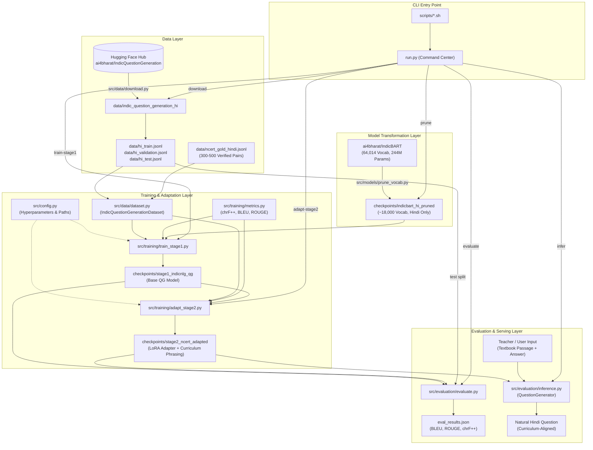
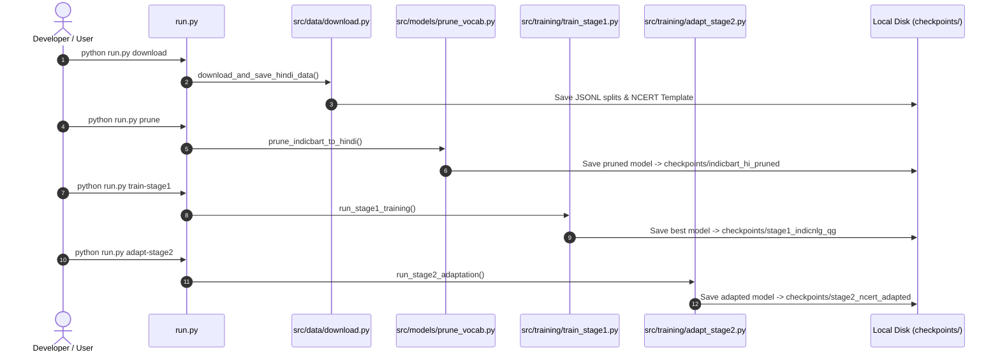

# Component Interactions & System Workflows

This document details the architectural connections, dataflow pipelines, and interface contracts among all modules in **Prashn-Setu**.

---

## 1. High-Level System Architecture Diagram

---

## 2. Step-by-Step Dataflow & Component Interaction

### Stage 0: Configuration Distribution
* **File:** [`src/config.py`](file:///mnt/a/iiits/5/NLP/PROJECT/src/config.py)
* **Consumers:** `src/data/`, `src/models/`, `src/training/`, `src/evaluation/`.
* **Mechanism:**
  Provides centralized dataclasses (`ModelConfig`, `DataConfig`, `TrainingConfig`). All file paths are dynamically anchored to `PROJECT_ROOT`.

---

### Stage 1: Data Acquisition & Preprocessing
* **Files involved:** [`src/data/download.py`](file:///mnt/a/iiits/5/NLP/PROJECT/src/data/download.py) $\to$ [`src/data/dataset.py`](file:///mnt/a/iiits/5/NLP/PROJECT/src/data/dataset.py)
* **Interaction:**
  1. `download.py` pulls only the `"hi"` configuration from `ai4bharat/IndicQuestionGeneration`.
  2. Saves local serialized JSONL files:
     * `data/hi_train.jsonl`
     * `data/hi_validation.jsonl`
     * `data/hi_test.jsonl`
  3. `dataset.py` wraps records into `IndicQuestionGenerationDataset`:
     * Combines Answer and Context: `"{answer} </s> {context} </s> <2hi>"`
     * Formats Target Question: `"<2hi> {question} </s>"`
     * Tokenizes with `add_special_tokens=False`
     * Sets label padding to `-100` for PyTorch loss masking.

---

### Stage 2: Vocabulary Pruning & Script Isolation
* **Files involved:** [`src/models/prune_vocab.py`](file:///mnt/a/iiits/5/NLP/PROJECT/src/models/prune_vocab.py) $\to$ `checkpoints/indicbart_hi_pruned/`
* **Interaction:**
  1. Inspects the 64,014 tokens of `ai4bharat/IndicBART`.
  2. Discards tokens containing Unicode ranges for Bengali, Gurmukhi, Gujarati, Oriya, Tamil, Telugu, Kannada, and Malayalam.
  3. Retains Devanagari characters, Latin/English characters, numbers, math symbols, and special tokens (`<s>`, `</s>`, `<pad>`, `<unk>`, `<mask>`, `<2hi>`).
  4. Slices `model.model.shared.weight` and `model.lm_head.weight` from `[64014, 1024]` to `[new_vocab_size, 1024]`.
  5. Serializes the compact model and mapping table to `checkpoints/indicbart_hi_pruned/`.

---

### Stage 3: Stage 1 Fine-Tuning (Large-Scale Silver Training)
* **Files involved:** [`src/training/train_stage1.py`](file:///mnt/a/iiits/5/NLP/PROJECT/src/training/train_stage1.py) $\longleftrightarrow$ [`src/data/dataset.py`](file:///mnt/a/iiits/5/NLP/PROJECT/src/data/dataset.py)
* **Interaction:**
  1. Loads pruned (or base) model and tokenizer.
  2. Instantiates training and validation `IndicQuestionGenerationDataset`.
  3. Launches `Seq2SeqTrainer` with `predict_with_generate=True`.
  4. Computes SacreBLEU, ROUGE-1/2/L, and **chrF++** via [`src/training/metrics.py`](file:///mnt/a/iiits/5/NLP/PROJECT/src/training/metrics.py).
  5. Selects and saves the best model checkpoint to `checkpoints/stage1_indicnlg_qg/`.

---

### Stage 4: Stage 2 NCERT Gold Domain Adaptation
* **Files involved:** [`src/training/adapt_stage2.py`](file:///mnt/a/iiits/5/NLP/PROJECT/src/training/adapt_stage2.py) $\longleftrightarrow$ `checkpoints/stage1_indicnlg_qg/`
* **Interaction:**
  1. Loads the Stage 1 checkpoint.
  2. Injects a parameter-efficient **LoRA (PEFT)** adapter targeting attention projection layers (`q_proj`, `v_proj`).
  3. Loads `data/ncert_gold_hindi.jsonl`, splitting it into 85% train and 15% validation.
  4. Trains with a small learning rate ($1\times 10^{-5}$) and early stopping patience of 2 epochs.
  5. Saves the LoRA adapter to `checkpoints/stage2_ncert_adapted/`.

---

### Stage 5: Inference & Generation Serving
* **Files involved:** [`src/evaluation/inference.py`](file:///mnt/a/iiits/5/NLP/PROJECT/src/evaluation/inference.py)
* **Interaction:**
  1. Instantiates `QuestionGenerator(checkpoint_path)`.
  2. Checks for `adapter_config.json`:
     * If present, loads the base model and attaches the LoRA adapter.
     * If absent, loads the full model checkpoint directly.
  3. Accepts passage and answer, formats tokens, and calls `.generate()` with `forced_bos_token_id=<2hi>` and repetition penalties.
  4. Cleans special tokens and returns natural Hindi question strings.

---

## 3. Sequence Diagrams

### Stage 1 & Stage 2 Training Sequence

