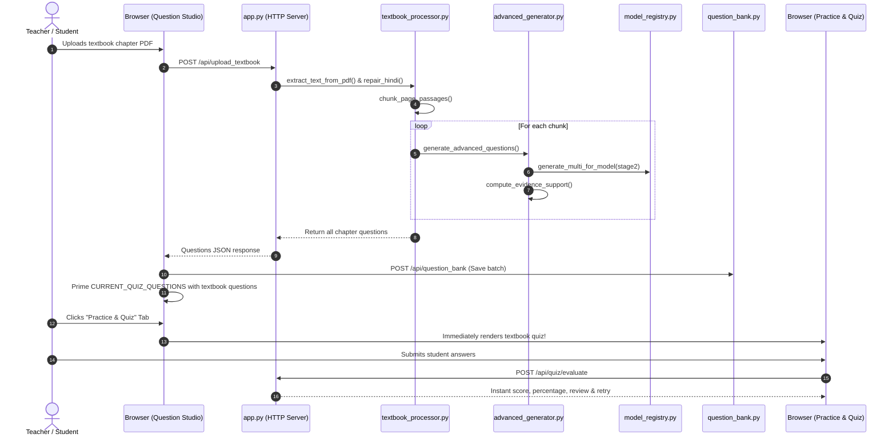

# Component Interactions & System Workflows

This document details the architectural connections, dataflow pipelines, and interface contracts among all modules in **Prashn-Setu**.

---

## 1. High-Level Platform Architecture

```mermaid
flowchart TD
    subgraph ClientLayer["1. Client / Presentation Layer (src/demo/index.html)"]
        UI1["Question Studio & Hub<br/>(Generate, Upload, Bank, Paper)"]
        UI2["Practice & Quiz Mode<br/>(Self-Assessment & Retry)"]
        UI3["Model Comparison<br/>(Stage 1 vs. Stage 2)"]
        UI4["Research & Diagnostics<br/>(Benchmarks, Errors & Health)"]
    end

    subgraph ServerLayer["2. Web Server & REST API (src/demo/app.py)"]
        HTTP["DemoHTTPRequestHandler<br/>(Python http.server, Port 7860)"]
        FontServer["Font Server<br/>(/fonts/NotoSansDevanagari)"]
        API1["/api/generate<br/>/api/upload_textbook"]
        API2["/api/question_bank<br/>/api/question_bank/stats"]
        API3["/api/quiz/evaluate<br/>/api/quiz/history"]
        API4["/api/paper/export/*<br/>/api/paper/validate"]
        API5["/api/compare<br/>/api/models"]
        API6["/api/benchmark_results<br/>/api/health"]
    end

    subgraph ProcessingLayer["3. Ingestion & Transformation Layer"]
        PDF["textbook_processor.py<br/>(pypdf, Devanagari Repair)"]
        Chunker["Sentence Boundary Chunker<br/>(150-250 words)"]
        CandidateExtractor["inference.py<br/>(extract_candidate_answers)"]
        AdvancedGen["advanced_generator.py<br/>(Categories, Difficulty, MCQs)"]
        EvidenceChecker["evidence_checker.py<br/>(Sentence Grounding & Offsets)"]
    end

    subgraph ModelLayer["4. Neural Model & Checkpoints"]
        Manager["model_registry.py<br/>(ModelManager Singleton)"]
        Stage1["checkpoints/stage1_indicnlg_qg<br/>(Base IndicBART 244M)"]
        Stage2["checkpoints/stage2_ncert_gold_lora<br/>(PEFT LoRA Adapter)"]
    end

    subgraph StorageLayer["5. Persistent Storage & Export"]
        DB[("data/question_bank.db<br/>(SQLite Database)")]
        PaperEngine["paper_builder.py<br/>(ReportLab PDF, CSV, JSON)"]
    end

    ClientLayer <--> ServerLayer
    API1 --> PDF --> Chunker --> AdvancedGen
    AdvancedGen --> CandidateExtractor
    AdvancedGen --> Manager
    Manager --> Stage2
    Manager -.->|with disable_adapter()| Stage1
    AdvancedGen --> EvidenceChecker
    AdvancedGen --> DB
    API2 --> DB
    API3 --> DB
    API4 --> PaperEngine
    API5 --> Manager
```

---

## 2. End-to-End Processing Workflows

### Workflow A: Single Passage Question Generation
1. **User Input:** User enters a Hindi context passage (or selects a preloaded NCERT textbook preset) and optional target answer in Tab 1.
2. **Devanagari Normalization:** Both client-side and backend engines apply `repair_hindi_devanagari_text()` to repair visual-order short-i matras (`ि`), reattach detached vowel signs, and normalize characters using Unicode `NFC`.
3. **Candidate Entity Extraction:** If no target answer is provided, `extract_candidate_answers()` scans the passage for salient entities (nouns, dates, numbers, Devanagari entities).
4. **Stage 2 LoRA Generation:** `ModelManager` invokes `generate_multi_for_model()` using the active Stage 2 LoRA adapter over Stage 1 base weights.
5. **Pedagogical Formatting & Distractor Synthesis:**
   - If category is `mcq`, `synthesize_mcq_options()` extracts 3 plausible in-passage distractors alongside the correct answer to build authentic 4-option questions.
   - For `conceptual`, `reasoning`, or `hots`, questions are framed with pedagogical interrogative markers.
6. **Sentence-Level Evidence Grounding:** `compute_evidence_support()` calculates lexical overlap with each passage sentence, identifying the exact supporting sentence and character offsets (`start_char`, `end_char`), assigning an answerability rating (`evidence_found`, `needs_review`, `unsupported`).
7. **Display:** The question card is rendered with an **inline collapsible context viewer** directly below the question.

---

### Workflow B: Textbook PDF Upload & Chapter Processing
1. **Upload:** User uploads an authentic NCERT textbook chapter (.pdf or .txt).
2. **Text Extraction & Normalization:** `extract_text_from_pdf()` extracts text page-by-page using `pypdf`, strips soft hyphens, repairs broken line-wrap syllables (`िसं\nह` $\to$ `सिंह`), and reorders visual matras.
3. **Sentence-Boundary Chunking:** `chunk_page_passages()` divides the chapter into balanced segments of 150–250 words without splitting mid-sentence.
4. **Batch Generation:** Chunks are processed sequentially through Stage 2 LoRA to prevent GPU/CPU memory exhaustion.
5. **Automatic Flow into Question Bank & Quiz:**
   - All generated chapter questions are automatically persisted into `data/question_bank.db` with source metadata.
   - Questions are automatically primed into `CURRENT_QUIZ_QUESTIONS`. Switching to Tab 2 (**Practice & Quiz**) immediately presents an interactive quiz on the uploaded textbook chapter.
   - Questions become immediately selectable in the **Paper Builder**.

---

### Workflow C: Multi-Model Comparison (Stage 1 vs. Stage 2)
1. **Fairness Parity:** When a passage is submitted to `/api/compare`, candidate answers are extracted **once** and supplied identically to both models.
2. **Zero-Reload Execution:**
   - Evaluates Stage 2 with active LoRA weights.
   - Evaluates Stage 1 with adapter dynamically bypassed via `with model.disable_adapter():`.
   - No weights are unloaded or reloaded from disk.
3. **Clean Side-by-Side Presentation:** Compares Stage 1 and Stage 2 directly with per-model latency metrics and 1-click blinded CSV export.

---

### Workflow D: Examination Paper Assembly & PDF Export
1. **Section Builder:** Teachers organize questions into sections (e.g. खंड 'क' - वस्तुनिष्ठ प्रश्न, खंड 'ख' - लघूत्तरीय प्रश्न, खंड 'ग' - दीर्घ उत्तरीय प्रश्न).
2. **Marks Validation:** `validate_paper_config()` verifies that the sum of question marks matches the exam total.
3. **Student Privacy Protection:** `generate_paper_pdf(include_answers=False)` generates the student question paper, strictly suppressing all answers and explanations.
4. **Dedicated Answer Key:** `generate_answer_key_pdf()` generates a separate evaluator copy with full answers, marks breakdown, and supporting evidence.
5. **Universal Typography:** Built using ReportLab and bundled `Noto Sans Devanagari` TrueType fonts, ensuring zero missing glyphs or square boxes on any OS.

---

## 3. Sequence Diagram: Textbook Upload to Interactive Quiz Flow


