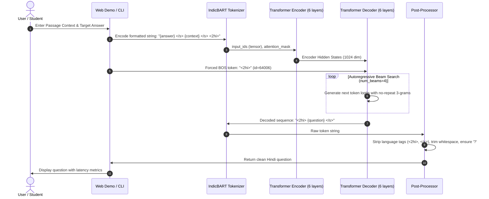
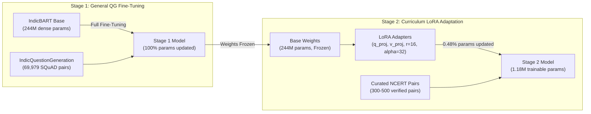

# Prashn-Setu: System Architecture & Dataflow Specification

This document details the architectural design, component interactions, dataflow pipelines, and safety mechanisms powering **Prashn-Setu: Automated Question Generation from Indic Educational Textbooks**.

---

## 1. High-Level System Architecture

Prashn-Setu is structured around a two-stage training paradigm, an audited inference and benchmarking engine, a dataset verification gate, and a zero-dependency web interface:

```mermaid
flowchart TD
    subgraph DataPipeline["1. Data Pipeline & Curation"]
        D1["IndicQuestionGeneration<br/>(Hindi SQuAD Translation: 98k)"] --> D2["hi_train / hi_val / hi_test splits"]
        D3["Authentic NCERT Textbooks<br/>(Grades 6-10: Science, History, Civics)"] --> D4["NCERT Gold Curation<br/>(Target: 300-500 verified pairs)"]
        D4 --> D5["Dataset Quality Validator<br/>(scripts/validate_dataset.py)"]
    end

    subgraph TrainingPipeline["2. Model Training & Adaptation"]
        T1["Pretrained IndicBART<br/>(ai4bharat/IndicBART, 244M)"] --> T2["Stage 1 Fine-Tuning<br/>(5 Epochs, AdamW, lr=3e-5)"]
        D2 --> T2
        T2 --> T3["Stage 1 Baseline Checkpoint<br/>(checkpoints/stage1_indicnlg_qg)"]
        T3 --> T4{"Stage 2 Safety Gate<br/>(N >= 50 verified?)"}
        D5 -->|Requires >= 300 Verified Pairs| T4
        T4 -->|BLOCKED (Currently N=3)| T5["Abort Training with Error"]
        T4 -->|READY| T6["Stage 2 LoRA Adaptation<br/>(q_proj, v_proj, r=16, alpha=32)"]
        T6 --> T7["Stage 2 NCERT Checkpoint<br/>(checkpoints/stage2_ncert_gold_lora)"]
    end

    subgraph EvaluationPipeline["3. Evaluation & Benchmarking"]
        T3 --> E1["Batch Inference Engine<br/>(QuestionGenerator, B=32)"]
        D2 -.->|10,553 Test Samples| E1
        E1 --> E2["Metric Computation Harness<br/>(SacreBLEU, chrF++, Hindi Whitespace ROUGE)"]
        E2 --> E3["Results & Artifacts<br/>(stage1_test_results_full.json)"]
        E1 --> E4["Stratified Sampling (N=100)"]
        E4 --> E5["Human Evaluation Protocol<br/>(results/human_eval_sample_100.csv)"]
        E5 --> E6["Human Eval & IAA Engine<br/>(scripts/analyze_human_eval.py)"]
    end

    subgraph ApplicationLayer["4. User Interfaces & Integration"]
        T3 --> I1["QuestionGenerator Engine (Stage 2 Primary + Stage 1 Base)"]
        I1 --> I2["Terminal CLI<br/>(python run.py infer)"]
        I1 --> I3["Web Demo Server<br/>(4 Workspaces, Bilingual UI, Inline Evidence, Font Serving)"]
        I1 --> I4["Automated Test Suite<br/>(49 Unit & Regression Tests)"]
    end
```

---

## 2. Sequence Layout & Tokenization Specification

IndicBART is a multilingual sequence-to-sequence model requiring explicit language identification tokens and delimiter tags. Prashn-Setu maintains strict parity between training and inference data pipelines:



### Token Identity Table

| Token Symbol | Token ID | Functional Purpose |
| :--- | :---: | :--- |
| `<pad>` | `0` | Batch padding; masked to `-100` in training loss calculation |
| `<unk>` | `1` | Out-of-vocabulary representation |
| `<s>` | `64000` | Sequence start marker |
| `</s>` | `64001` | Section separator between Answer and Context; sequence termination |
| `<2hi>` | `64006` | Hindi language tag; required as prefix for target generation |

---

## 3. Two-Stage Training & Adaptation Design



### Parameter Efficiency Comparison

| Dimension | Stage 1 Fine-Tuning | Stage 2 LoRA Adaptation |
| :--- | :--- | :--- |
| **Base Weights** | Full Backpropagation | **100% Frozen** |
| **Trainable Parameters** | 244,196,800 (100.0%) | **1,179,648 (0.481%)** |
| **Target Modules** | All weights | `q_proj`, `v_proj` (Attention Projections) |
| **LoRA Rank ($r$)** | N/A | 16 |
| **LoRA Alpha ($\alpha$)** | N/A | 32 |
| **Learning Rate** | $3 \times 10^{-5}$ | $1 \times 10^{-5}$ |
| **Catastrophic Forgetting Risk** | High if trained on small data | **Near Zero** |

---

## 4. Module Responsibilities & Directory Layout

```
PROJECT/
├── run.py                          # Unified CLI orchestrator (10 subcommands)
├── architecture/                   # Architectural notes & system tracker
├── checkpoints/
│   ├── stage1_indicnlg_qg/         # Preserved 5-epoch IndicBART baseline
│   └── stage2_ncert_gold_lora/     # Isolated Stage 2 LoRA output directory
├── data/
│   ├── hi_train.jsonl              # Stage 1 training split (69,979 pairs)
│   ├── hi_validation.jsonl         # Stage 1 validation split (17,495 pairs)
│   ├── hi_test.jsonl               # Stage 1 held-out test split (10,553 pairs)
│   └── ncert_gold_hindi.jsonl      # Stage 2 curriculum dataset (pending curation)
├── docs/
│   ├── ARCHITECTURE.md             # This document
│   ├── TECHNICAL_REPORT.md         # Comprehensive research paper
│   ├── NCERT_GOLD_CURATION_GUIDE.md# 5-point textbook annotation rubric
│   └── EXPERIMENT_LOG.md           # Chronological run history
├── results/
│   ├── stage1_test_results_full.json # Audited 10,553-sample benchmark
│   ├── stage1_smoke_test.json      # 10-scenario regression outputs
│   ├── stage1_qualitative_analysis.json # Error taxonomy case studies
│   ├── QUALITATIVE_ERROR_ANALYSIS.md # Detailed qualitative findings
│   ├── human_eval_sample_100.csv   # 100-sample stratified test predictions
│   ├── human_eval_clean_template.csv # Clean reviewer scoring template
│   └── HUMAN_EVALUATION_PROTOCOL.md # 5-dimension rubric & IAA instructions
├── scripts/
│   ├── analyze_human_eval.py       # Human evaluation & agreement engine
│   └── validate_dataset.py         # Dataset schema, grounding, & split validator
├── src/
│   ├── config.py                   # ModelConfig, DataConfig, TrainingConfig
│   ├── data/
│   │   ├── dataset.py              # IndicQuestionGenerationDataset
│   │   └── download.py             # Split export & disk persistence
│   ├── demo/
│   │   └── app.py                  # Zero-dependency browser web server (port 7860)
│   ├── evaluation/
│   │   ├── inference.py            # QuestionGenerator (single & batch)
│   │   └── evaluate.py             # Full-test benchmark runner
│   ├── models/
│   │   └── prune_vocab.py          # IndicBART Hindi vocabulary pruner (quarantined)
│   ├── training/
│   │   ├── train_stage1.py         # Full fine-tuning script
│   │   ├── adapt_stage2.py         # LoRA curriculum adaptation script
│   │   └── metrics.py              # Seq2Seq compute_metrics builder
│   └── utils/
│       └── tracker.py              # SYSTEM_STATE_TRACKER auto-refresher
└── tests/
    ├── fixtures/                   # Marked synthetic evaluation test fixtures
    ├── test_baseline_smoke.py      # 10-scenario baseline smoke test
    ├── test_dataset_validation.py  # Dataset schema and leakage tests
    ├── test_preprocessing.py       # Sequence formulation and padding tests
    ├── test_metrics.py             # BLEU, chrF++, and Hindi ROUGE tests
    ├── test_stage2_safety.py       # LoRA configuration and abort guard tests
    ├── test_human_eval_analysis.py # Human evaluation statistics and IAA tests
    └── test_demo_server.py         # Web server endpoints and generation API tests
```

---

## 5. Verification & Safety Guardrails

Prashn-Setu incorporates multiple automated safety mechanisms:
1. **Stage 2 Insufficient Data Abort:** If `train_records < 50`, `run_stage2_adaptation` throws `ValueError` before instantiating the optimizer, protecting the base model.
2. **Directory Isolation:** Stage 2 outputs to `checkpoints/stage2_ncert_gold_lora`, preventing accidental destruction of `checkpoints/stage1_indicnlg_qg`.
3. **Cross-Split Contamination Check:** `scripts/validate_dataset.py` detects duplicate context passages or IDs across splits to prevent evaluation leakage.
4. **Devanagari Grounding Check:** Validates that supplied answers are authentic substrings of the context passage.
5. **Vocabulary Pruner Quarantine:** The vocabulary pruner is flagged as defective and quarantined because modifying the embedding matrix without updating the SentencePiece tokenizer tokenizer vocabulary table results in severe token corruption.
