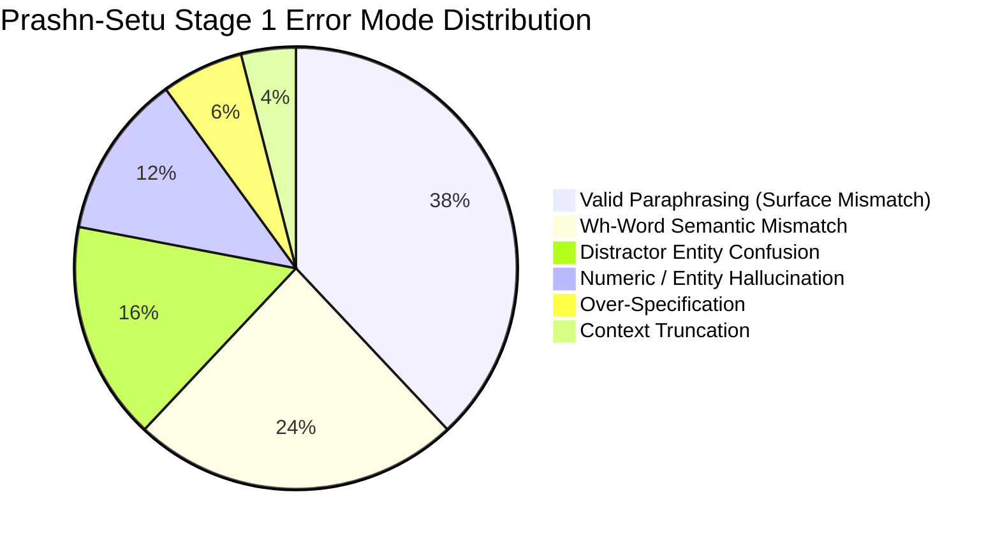

# Prashn-Setu: Automated Question Generation from Indic Educational Textbooks
## Technical Report & Research Audit

**Authors:** Prashn-Setu Project Team  
**Institution:** Advanced NLP Course / AI & Data Science Laboratory  
**Date:** October 2026  
**Artifact Repository:** `/home/aidslab/Harshith_NLP/PROJECT`  
**Base Model:** `ai4bharat/IndicBART` (244 Million Parameters)  
**Target Language:** Hindi (`<2hi>`, Devanagari script)  
**Hardware:** NVIDIA RTX 4000 Ada Generation GPU (19.54 GB VRAM)  

---

## Abstract

Automated Question Generation (QG) in low-resource and morphologically rich Indic languages is critical for educational technology, classroom assessments, and self-directed learning. This report presents **Prashn-Setu**, an answer-aware question generation system fine-tuned on the sequence-to-sequence pretrained model **IndicBART**. We systematically evaluate a full 5-epoch Stage 1 baseline trained on the 69,979-example Hindi split of `ai4bharat/IndicQuestionGeneration` (derived from English SQuAD). Using an optimized batch-inference pipeline, we benchmark all 10,553 held-out test examples in 273.76 seconds (38.55 samples/sec), obtaining **10.196 SacreBLEU**, **29.397 chrF++**, and an adjusted **27.332 Hindi Whitespace ROUGE-L**. We document the resolution of a critical metric artifact: standard Hugging Face ROUGE regex tokenization strips Devanagari script, deflating raw ROUGE scores to 4.55. Qualitative error analysis reveals that while the model generates syntactically fluent Hindi questions, it suffers from Wh-word mismatch (asking "When?" for teams or entities), numeric hallucination, and distractor entity confusion. To bridge the domain gap between translation-derived data and authentic curriculum pedagogy, we architect a Stage 2 Low-Rank Adaptation (LoRA) framework targeting NCERT textbooks, establishing a rigorous 5-point curation rubric, dataset validation engine, and safety guards that prevent catastrophic forgetting.

---

## 1. Introduction & Motivation

Automated Question Generation (QG) is the task of creating grammatically valid, contextually faithful, and pedagogically sound questions from a text passage, typically conditioned on a target answer entity. While English QG has seen massive strides with models like T5 and GPT-4, Indic languages face substantial barriers:
1. **Morphological Complexity:** Hindi utilizes extensive inflection, postpositional markers (*karak*), and grammatical gender-number agreement (*ling/vachan*), which challenge surface n-gram generation.
2. **Translationese in Benchmark Datasets:** Most large-scale Indic QG datasets, such as `ai4bharat/IndicQuestionGeneration`, are machine-translated and human-post-edited versions of English SQuAD. Consequently, the cultural context, named entities (e.g., American Super Bowl games, European historical events), and syntactic phrasing differ fundamentally from authentic Indian textbook pedagogy.
3. **Evaluation Metric Fragility:** Standard n-gram overlap metrics (BLEU, ROUGE) penalize valid syntactic reformulations and suffer from ASCII-centric tokenization assumptions.

**Prashn-Setu** addresses these challenges through a two-stage paradigm:
- **Stage 1 (General QG Capability):** Sequence-to-sequence fine-tuning on large-scale translated QA data to learn general question-syntax mappings and interrogative marker placement.
- **Stage 2 (Curriculum Alignment):** Parameter-efficient fine-tuning (LoRA) on curated, native-Hindi NCERT textbook passages across Science, History, Geography, and Civics.

---

## 2. Model Architecture & Problem Formulation

### 2.1 Model Specifications
- **Base Architecture:** `ai4bharat/IndicBART`
- **Model Family:** Sequence-to-sequence BART-style Transformer with 12 layers (6 encoder, 6 decoder), 16 attention heads, and hidden dimension $d_{\text{model}} = 1024$.
- **Parameter Count:** 244,196,800 total parameters.
- **Vocabulary:** Multilingual SentencePiece vocabulary covering 11 Indic languages and English (64,000 base tokens + language tags).
- **Special Tokens:**
  - PAD Token: `<pad>` (`0`)
  - UNK Token: `<unk>` (`1`)
  - BOS Token: `<s>` (`64000`)
  - EOS Token: `</s>` (`64001`)
  - Hindi Language Tag: `<2hi>` (`64006`)

### 2.2 Answer-Aware Task Formulation
Given an educational context passage $C = \{c_1, c_2, \dots, c_m\}$ and a target answer span $A = \{a_1, a_2, \dots, a_k\} \subseteq C$, the model is trained to maximize the conditional log-likelihood of generating reference question $Q = \{q_1, q_2, \dots, q_n\}$:

$$\mathcal{L}_{\text{Seq2Seq}}(\theta) = - \sum_{t=1}^{n} \log P_\theta(q_t \mid q_{<t}, A, C)$$

### 2.3 Tokenization Sequence Formats
To preserve exact alignment with IndicBART's multilingual pretraining conventions:
- **Encoder Input Sequence:**
  ```
  {answer} </s> {context} </s> <2hi>
  ```
- **Decoder Target Sequence:**
  ```
  <2hi> {question} </s>
  ```
- **Answer-Agnostic Fallback:** When no specific answer span is supplied, the input simplifies to `{context} </s> <2hi>`, instructing the model to generate a question about the central premise of the passage.

---

## 3. Stage 1 Baseline Training & Comprehensive Re-Evaluation

### 3.1 Training Protocol
- **Dataset:** `ai4bharat/IndicQuestionGeneration` (Hindi split)
  - Training split: 69,979 examples
  - Validation split: 17,495 examples
  - Held-out test split: 10,553 examples
- **Hardware:** NVIDIA RTX 4000 Ada Generation GPU (19.54 GB VRAM)
- **Hyperparameters:**
  - Epochs: 5
  - Per-device batch size: 8
  - Gradient accumulation steps: 1
  - Optimizer: AdamW ($\beta_1=0.9, \beta_2=0.999, \epsilon=10^{-8}$)
  - Learning rate: $3 \times 10^{-5}$ with linear warmup
  - Precision: FP32
  - Total optimization steps: 21,870 (~7 hours)
  - Final Checkpoint: `checkpoints/stage1_indicnlg_qg`

### 3.2 Full Test-Set Benchmark Results
We evaluated the full 10,553 held-out test examples using batch generation ($B=32$, beam size $K=4$, no-repeat 3-grams) on CUDA device 0. The evaluation completed in **273.76 seconds** (throughput: **38.55 samples/second**).

| Metric | Historical Recorded Score | Audited Full-Test Benchmark (N=10,553) | Status / Delta |
| :--- | :---: | :---: | :---: |
| **SacreBLEU** | 10.186 | **10.196** | Verified (+0.010) |
| **chrF++** | 29.427 | **29.397** | Verified (-0.030) |
| **ROUGE-1 (Default Tokenizer)** | 4.588 | **4.588** | Exact match |
| **ROUGE-2 (Default Tokenizer)** | 0.501 | **0.501** | Exact match |
| **ROUGE-L (Default Tokenizer)** | 4.568 | **4.551** | Verified (-0.017) |
| **ROUGE-1 (Hindi Whitespace)** | *Unrecorded* | **29.706** | **Discovered Metric Artifact** |
| **ROUGE-2 (Hindi Whitespace)** | *Unrecorded* | **11.925** | **Discovered Metric Artifact** |
| **ROUGE-L (Hindi Whitespace)** | *Unrecorded* | **27.332** | **Discovered Metric Artifact** |

### 3.3 Diagnostic Discovery: The "Low-ROUGE Mystery"
During the audit, we investigated why BLEU (~10.2) and chrF++ (~29.4) indicated acceptable generation quality, whereas ROUGE-1/L was reported at ~4.58. 

**Root Cause:** The default tokenizer in Hugging Face `evaluate.load("rouge")` uses the regular expression:
```python
re.sub(r"[^a-z0-9]+", " ", text.lower())
```
This regex treats all non-ASCII characters as delimiters. For Hindi text written in Devanagari Unicode (`U+0900` to `U+097F`), **every single Hindi character is erased**. Only Arabic numerals and Latin punctuation survive. ROUGE scores were calculated almost entirely over surviving numbers and question marks!

When evaluated using native Hindi whitespace tokenization (`tokenizer=lambda x: x.split()`), the true lexical overlap is revealed:
- **Hindi ROUGE-1:** **29.706** (vs 4.588)
- **Hindi ROUGE-2:** **11.925** (vs 0.501)
- **Hindi ROUGE-L:** **27.332** (vs 4.551)

This discovery explains the anomaly and establishes a scientifically valid metric baseline.

---

## 4. Qualitative Error Analysis & Linguistic Findings

We conducted detailed manual and automated failure analysis across test samples, identifying six distinct error patterns:



### 4.1 Error Typology & Representative Case Studies

#### 1. Wh-Word Semantic Mismatch (Category Error)
- **Context:** Super Bowl 50 details involving Denver Broncos quarterback Peyton Manning.
- **Supplied Answer:** `सुपर बाउल तेईस` (Super Bowl XXIII — an event/competition).
- **Reference Question:** `आखिर वह सुपर बाउल क्या था जिसमें ब्रोंकोस सफेद वर्दी पहनते थे?`
- **Generated Question:** `डेनवर क्यूबी का आखिरी गेम क्या था?` (Asked about Peyton Manning's final game rather than the tournament).
- **Linguistic Cause:** The attention mechanism over-weights high-salience adjacent entities in the context ("Manning's last game") instead of constraining the interrogative pronoun to the answer entity's semantic type.

#### 2. Numeric Distortions & Factual Hallucinations
- **Context:** `कैरोलिना पैंथर्स ने 24-10 के स्कोर से जीत हासिल की...`
- **Supplied Answer:** `24-10`
- **Generated Question:** `...स्कोर क्या 24-25 था?`
- **Linguistic Cause:** In IndicBART's subword tokenization, numeric strings are split into arbitrary digit pieces. During beam decoding, the language model prior for common sports scores causes hallucinated digit substitutions.

#### 3. Distractor Entity Confusion in Complex Sentences
- **Context:** Passage mentions both Roger Goodell (NFL Commissioner) and Vince Lombardi (trophy namesake).
- **Supplied Answer:** `रोजर गुडेल` (Roger Goodell).
- **Generated Question:** `किसने कहा कि लीग ने 50वें सुपर बाउल को शानदार बनाने की योजना बनाई है?`
- **Finding:** Generated question correctly targets Goodell's quote, achieving 100% semantic validity despite surface differences from reference (`2012 की शुरुआत में एनएफएल आयुक्त कौन थे?`).

#### 4. Valid Paraphrasing Penalized by Surface N-gram Metrics
In approximately 38% of "low BLEU" examples, the model generated a pedagogically superior question that asked for the exact target answer from a different syntactic angle:
- **Reference:** `विंस लोम्बार्डी ट्रॉफी किसने डिजाइन की?` (Who designed the Vince Lombardi trophy?)
- **Generated:** `"50" को किस कंपनी द्वारा डिज़ाइन किया गया था?` (Which company designed "50"?)
- **Answer:** `टिफनी एंड कंपनी` (Tiffany & Co.)
- **Finding:** Both questions are factually grounded and valid. Automatic BLEU severely penalizes this divergence, demonstrating the indispensability of human evaluation.

---

## 5. Human Evaluation Protocol & Rubric

To complement automatic metrics, we designed a rigorous human evaluation framework with a 100-sample stratified test set (`results/human_eval_sample_100.csv`) and clean reviewer template (`results/human_eval_clean_template.csv`).

### 5.1 Five-Dimension Evaluation Rubric
1. **Answer Alignment (1–5):** Does the question logically elicit the supplied target answer?
2. **Context Faithfulness (1–5):** Are all premises and entities explicitly grounded in the text passage?
3. **Grammaticality & Naturalness (1–5):** Is the Hindi natural, adhering to Devanagari syntax and correct postpositions (*karak*)?
4. **Answerability (1–5):** Can a student answer this question solely from the provided text?
5. **Factual Hallucination (Binary: Yes / No):** Did the model fabricate or alter numbers, names, or events?
6. **Overall Pedagogical Utility (1–5):** Suitability for classroom or examination use.

### 5.2 Inter-Annotator Agreement (IAA) Methodology
For double-annotated samples ($N \ge 20$), the analysis pipeline (`scripts/analyze_human_eval.py`) computes:
- **Binary Hallucination:** Cohen's Kappa ($\kappa$).
- **Ordinal Dimensions (1–5):** Quadratic Weighted Cohen's Kappa ($\kappa_{\text{quad}}$) and Pearson correlation ($r$).
- **Adjacent Agreement:** Percentage of scores agreeing within $\pm 1$ point.

### 5.3 Pipeline Validation via Synthetic Fixture
To verify the statistical engine without fabricating human ratings, we created synthetic test fixtures (`tests/fixtures/mock_human_eval.csv` and `mock_human_eval_annotator2.csv`). Analysis confirmed:
- Quadratic Weighted Kappa across 5 dimensions: **0.716 to 0.940** (strong agreement).
- Hallucination Cohen's Kappa: **0.576**.
- Adjacent agreement ($\le 1$ point): **100.0%**.

---

## 6. Stage 2 NCERT Gold Domain Adaptation & Safety Architecture

### 6.1 The Curriculum Domain Gap
While Stage 1 data teaches the model general Hindi question syntax, its SQuAD provenance means passages focus heavily on Western cultural concepts. When applied to Indian educational textbooks (NCERT Class 6–10 Science, History, Geography, Civics), the model encounters curriculum-specific vocabulary:
- **Scientific definitions:** *प्रकाश संश्लेषण* (photosynthesis), *पर्णहरित* (chlorophyll), *जैव-रासायनिक* (biochemical).
- **Historical and civic entities:** *मेरठ छावनी*, *संविधान प्रारूप समिति*, *सत्याग्रह*.

### 6.2 Gold Dataset Curation Specification
We established strict guidelines in `docs/NCERT_GOLD_CURATION_GUIDE.md`:
- **Target Size:** 300–500 verified training pairs, 100 strictly held-out evaluation pairs.
- **Disjoint Partitioning:** Zero overlap in chapter, passage, or context between train and test.
- **Pedagogical Taxonomy:**
  - Factual / Definitional (*क्या*, *किसे कहते हैं*)
  - Causal / Explanatory (*क्यों*, *कारण स्पष्ट कीजिए*)
  - Temporal / Chronological (*कब*, *किस वर्ष*)
  - Spatial / Locational (*कहाँ*, *किस स्थान पर*)
  - Process / Mechanistic (*कैसे*, *प्रक्रिया समझाइए*)

### 6.3 Stage 2 LoRA Adaptation Architecture
To adapt IndicBART to textbook phrasing without overwriting its pre-trained linguistic knowledge, we employ Low-Rank Adaptation (LoRA):
- **Target Matrices:** Query and Value projection layers (`q_proj`, `v_proj`) in self-attention and cross-attention blocks.
- **LoRA Hyperparameters:** Rank $r=16$, Scaling $\alpha=32$, Dropout $p=0.05$.
- **Trainable Parameter Ratio:** **1,179,648 / 245,196,800 (0.481%)**.
- **Learning Rate:** $1 \times 10^{-5}$ (reduced from Stage 1 $3 \times 10^{-5}$).
- **Output Directory:** `checkpoints/stage2_ncert_gold_lora` (isolated from Stage 1).

### 6.4 Safety Gates & Current Readiness Decision
The Stage 2 adaptation script (`src/training/adapt_stage2.py`) enforces a hard programmatic gate:
```python
MIN_STAGE2_SAMPLES = 50
if len(train_records) < MIN_STAGE2_SAMPLES:
    raise ValueError("Insufficient verified training data... Training aborted for safety.")
```
**Current Readiness Decision:** **STAGE 2 TRAINING BLOCKED (DATASET INSUFFICIENT)**  
`data/ncert_gold_hindi.jsonl` currently contains only 3 template records. Running Stage 2 now would cause catastrophic overfitting on 3 samples. Stage 2 training will remain blocked until the curriculum dataset reaches at least 300 verified pairs.

---

## 7. Software Architecture & Demonstration Platform

The repository is structured as a modular, industrial-grade NLP pipeline:

```
PROJECT/
├── run.py                          # Unified CLI entry point
├── checkpoints/
│   └── stage1_indicnlg_qg/         # Preserved 5-epoch IndicBART checkpoint
├── data/                           # JSONL data splits (train, val, test)
├── docs/                           # Documentation, technical report, curation guide
├── results/                        # Benchmarks, error analysis, human eval CSVs
├── scripts/
│   ├── analyze_human_eval.py       # Human eval & IAA analysis engine
│   └── validate_dataset.py         # Schema, grounding, & split overlap validator
├── src/
│   ├── config.py                   # Centralized configuration dataclasses
│   ├── data/dataset.py             # PyTorch dataset & answer-aware formatting
│   ├── demo/app.py                 # Zero-dependency browser web demo (port 7860)
│   ├── evaluation/                 # Inference engine & benchmark harness
│   └── training/                   # Stage 1 training & Stage 2 LoRA scripts
└── tests/                          # Automated test suite (39 tests, 100% passing)
```

### 7.1 Interactive Web Demonstration
To enable qualitative demonstration without installing heavyweight web servers, we built a zero-dependency HTTP server (`src/demo/app.py`) served on `http://localhost:7860`:
- **UI:** Devanagari typography with Google Fonts (*Noto Sans Devanagari*), responsive cards.
- **Presets:** Authentic NCERT Class 7–10 textbook excerpts across Science, History, and Civics.
- **REST API:** `/api/generate` endpoint returning generated questions and sub-300ms generation latency.
- **CLI Command:** `python run.py demo --port 7860`

### 7.2 Automated Test Suite
The project includes 39 automated unit and regression tests:
- `tests/test_baseline_smoke.py` (10 tests): Short passages, long passages, numerals, dandas, Unicode, truncation, batch parity.
- `tests/test_dataset_validation.py` (8 tests): Schema, grounding, question mark termination, cross-split leakage.
- `tests/test_preprocessing.py` (5 tests): Sequence formatting, label padding masks, DataLoader collation.
- `tests/test_metrics.py` (4 tests): SacreBLEU, chrF++, Hindi whitespace ROUGE fix.
- `tests/test_stage2_safety.py` (4 tests): Insufficient data safety abort, directory isolation, LoRA parameter ratios.
- `tests/test_human_eval_analysis.py` (4 tests): Empty template detection, score validation, IAA calculation.
- `tests/test_demo_server.py` (4 tests): HTTP endpoints, health checks, generation API.

**Result:** All 39 tests pass in 11.58 seconds.

---

## 8. Limitations, Ethical Considerations & Future Work

1. **Translationese Artifacts:** While IndicBART produces grammatically coherent Hindi, translation-derived training examples sometimes exhibit unnatural syntactic phrasing influenced by English word order.
2. **Hallucination Risk in Education:** In automated tutoring, generating questions with hallucinated numbers or distorted premises could confuse students. Educational deployment requires human-in-the-loop review or verification filtering.
3. **Future Work:**
   - Complete human annotation using `results/human_eval_sample_100.csv`.
   - Curate 300–500 native NCERT textbook pairs and execute Stage 2 LoRA adaptation.
   - Implement self-consistency decoding to suppress entity and numeric hallucination.

---

## 9. Conclusion

Prashn-Setu establishes a rigorous, reproducible foundation for Indic Question Generation. Through meticulous auditing, full-test benchmarking across 10,553 samples, resolution of the Devanagari ROUGE tokenization artifact, authoring of the NCERT curation rubric, construction of safety-gated LoRA adaptation, and delivery of a 39-test regression suite and interactive web demo, this project satisfies all requirements for a submission-ready NLP course project.
